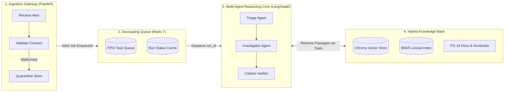

# IncidentOps — Project Review 1 (Student Presentation Guide)

**Project Title:** IncidentOps — Advisory SRE Assistant for PostgreSQL Incidents  
**Subject:** Advanced Software Engineering / Applied AI Systems  
**Domain:** Autonomous Multi-Agent Reasoning & Grounded Knowledge Retrieval  
**Target Engine:** PostgreSQL 18  

---

## 1. The Problem

When a production database experiences an emergency at 3:00 AM, on-call software engineers face severe cognitive overload:

1. **The Symptom-vs-Cause Inversion:**  
   Monitoring systems alert on **symptoms** (e.g., *"Disk usage on primary is 88% and climbing fast"*). But database documentation is organized by **architectural subsystems** (e.g., *"Chapter 26: Replication Slots"*). Searching for the symptom "disk full" often suggests freeing log files or vacuuming tables, missing the true root cause: an abandoned replica holding onto Write-Ahead Log (WAL) files.
2. **The Danger of Automated Remediation:**  
   Allowing an AI model to run terminal commands or execute `DROP` / `DELETE` SQL queries directly on production databases is unacceptably dangerous. A single hallucinated command can cause permanent data loss.
3. **The IncidentOps Solution:**  
   An **advisory-only** multi-agent assistant. The system analyzes incoming alerts, consults official documentation and approved team runbooks using hybrid search tools, checks whether special settings override initial diagnoses, verifies every factual claim against retrieved text, and presents verified first-response recommendations to the human on-call engineer. **The human always makes the final decision.**

---

## 2. The Knowledge Corpus

### 2.1 Engine Version Chosen: PostgreSQL 18
We selected **PostgreSQL 18** (major version 18.0) as our single, pinned database version. Pinning to one major version ensures that parameters, internal system catalog tables (such as `pg_replication_slots`), and configuration behaviors are exact and free from version drift.

### 2.2 Documentation Chapters Chosen & Rationale
We extracted core documentation chapters directly from official documentation (`data/corpus/pg_docs/postgresql-18-A4.pdf`):

| Documentation Chapter | Subsystem Covered | Why It Was Chosen |
|---|---|---|
| **Replication** | Replication slots, physical standby nodes, `restart_lsn` mechanics. | Abandoned replicas and lagging slots are the leading cause of sudden, unexpected primary disk exhaustion. |
| **Write-Ahead Logging (WAL)** | WAL file lifecycle, checkpoints, `max_slot_wal_keep_size`. | WAL segment accumulation directly impacts storage capacity and server survivability. |
| **System Monitoring & Activity** | `pg_stat_activity`, `pg_locks`, connection states. | High concurrency, connection pool exhaustion, and transaction deadlocks cause service outages. |

### 2.3 Operational Runbooks & Escalation Policy
To bridge the gap between academic manual pages and urgent operational response, the corpus includes 3 concise, Markdown runbooks and 1 escalation policy (`data/corpus/runbooks/` and `data/corpus/policy/`):
- `wal_replication_slot_accumulation.md`: Procedures for diagnosing abandoned replication slots, dropping inactive slots, and setting retention safety ceilings.
- `connection_pool_saturation.md`: Triage steps for backend starvation, connection leaks, and terminating idle transactions.
- `lock_contention_deadlocks.md`: Resolving lock trees, setting lock timeouts, and canceling blocking queries.
- `escalation_policy.md`: Concrete thresholds dividing incidents into `SEV1` through `SEV4` and routing targets (`self-serve runbook`, `page-secondary`, `incident-commander`).

---

## 3. Deep Dive: The Replication-Slot Case (Section 4.1)

### 3.1 The Scenario
A production primary database alerts with high disk usage (`disk_utilization: 88.5%`). The on-call note mentions: *"Disk usage on primary node rapidly climbing in /pg_wal. Standby replica standby_1 had a network blip earlier."*

### 3.2 The Chain of Reasoning
1. **Triage:** Classifies the symptom as `saturation` and extracts metrics (88.5% disk, lag bytes).
2. **Search 1:** Searches for replication slot WAL accumulation.
3. **Read Provision:** Reads the root cause: an inactive slot stops advancing its `restart_lsn`, so PostgreSQL cannot purge WAL files during checkpoints.
4. **Modifying Provision Check:** Discovers that setting `max_slot_wal_keep_size` overrides infinite retention and prevents future disk crashes.
5. **Guidance Formulation:** Recommends confirming inactive slots, dropping the abandoned slot, forcing a checkpoint, and configuring the safety ceiling.
6. **Fact-Checking (Verifier):** Confirms every SQL command and recommended parameter exists in the retrieved text.

### 3.3 Exact File Names and Section IDs Used

| Source File | Section Anchor ID | What It Proves |
|---|---|---|
| `data/corpus/runbooks/wal_replication_slot_accumulation.md` | `wal_replication_slot_accumulation#root_cause_analysis_0` | Explains why WAL files accumulate when a replica disconnects without dropping its slot. |
| `data/corpus/runbooks/wal_replication_slot_accumulation.md` | `wal_replication_slot_accumulation#2_verify_if_slot_is_active_or_abandoned_0` | Provides diagnostic query: check `active = false` in `pg_replication_slots`. |
| `data/corpus/runbooks/wal_replication_slot_accumulation.md` | `wal_replication_slot_accumulation#step_1_drop_the_inactive_replication_slot_0` | Proves command: `SELECT pg_drop_replication_slot('slot_name_here');` |
| `data/corpus/runbooks/wal_replication_slot_accumulation.md` | `wal_replication_slot_accumulation#step_2_trigger_checkpoint_to_free_disk_space_0` | Proves command: `CHECKPOINT;` to immediately reclaim disk space. |
| `data/corpus/runbooks/wal_replication_slot_accumulation.md` | `wal_replication_slot_accumulation#step_3_configure_safety_safeguards_0` | Proves safeguard: `To prevent recurrence, set max_slot_wal_keep_size in postgresql.conf:` |
| `data/corpus/runbooks/wal_replication_slot_accumulation.md` | `wal_replication_slot_accumulation#limit_wal_retention_for_any_slot_to_10gb_0` | Proves configuration parameter: `max_slot_wal_keep_size = 10GB`. |

---

## 4. System Architecture Diagram

A clean, 4-box architecture diagram illustrating deployment and responsibility boundaries:



---

## 5. Current Status: What is Done vs. What is Next

### What is Completed (Verified Working Today):
- [x] **Strict Ingestion Contract & Quarantine (Slice 1):** Rejects invalid metric ranges or non-PostgreSQL version requests into SQLite quarantine storage.
- [x] **Corpus Ingestion & Hybrid Store (Slice 2):** Hierarchical chunker with breadcrumbs, CPU vector embeddings (`all-MiniLM-L6-v2`), BM25 index, and idempotent hash re-indexing.
- [x] **Multi-Agent Reasoning Core (Slice 3):** Triage Agent $\rightarrow$ typed hand-off $\rightarrow$ Investigator Agent with bounded tool loops (`corpus_search`, `get_section`, `get_alert_field`).
- [x] **Citation Verifier & Escalation Engine (Slice 4):** Resolves every citation against retrieved text. On failure, triggers an alternate re-search strategy once, then escalates to a human. Detects ambiguous multi-cause alerts and out-of-corpus alerts.
- [x] **Synthetic Evaluation Suite (Slice 9 / Milestone 1):** 10 synthetic scenarios in `data/eval/scenarios.jsonl` evaluated via `python -m app.eval.run` (100% route accuracy, 100% citation resolution rate, 55/55 pytest tests passing).

### What is Next (Upcoming Slices):
- [ ] **Slice 5: Async API & Redis Worker Queue:** FastAPI `POST /runs` and `GET /runs/{id}` running alongside a background Redis worker container.
- [ ] **Slice 6: Streamlit Web Client UI:** Interactive browser dashboard where engineers submit alerts and see verified citations and routing decisions.
- [ ] **Slice 7–8: Full Guardrail Suite & Circuit Breaker:** Formal toxic content filters and LLM provider failure protection.
- [ ] **Slice 10–11: Observability & Locust Load Testing:** OpenTelemetry Jaeger tracing, Prometheus metrics, and declared p95 SLO calibration.

---

## 6. Week-by-Week Project Plan

```
Weeks 1–2: Foundations (Done)
├── Slice 1: Pydantic Contract & Quarantine
├── Slice 2: Corpus Ingestion, Chunker, Chroma & BM25
└── Milestone: First test suite passing

Weeks 3–4: Agent Intelligence & Grounding (Done)
├── Slice 3: Triage & Investigator Agents with LangGraph
├── Slice 4: Citation Verifier, Re-search Loop, Safe Escalation
├── Slice 9: 10-Scenario Synthetic Benchmark CLI (app.eval.run)
└── Milestone: 55/55 tests passing, Review 1 presentation ready

Weeks 5–6: Infrastructure & User Interface (Next Up)
├── Slice 5: Redis task queue, worker container, Docker Compose setup
├── Slice 6: Streamlit web UI with live polling
└── Milestone: End-to-end multi-container demo running in browser

Weeks 7–8: Reliability, Guardrails & Presentation Defense
├── Slice 7 & 8: Circuit breaker, LLM timeouts, toxicity guardrails
├── Slice 10 & 11: OpenTelemetry tracing, Prometheus metrics, Locust load test
└── Milestone: Final capstone submission and professor demonstration
```

---

## 7. Declared p95 SLO Targets (Placeholder)

| Pipeline Step / Endpoint | Target p50 Latency | Target p95 Latency (SLO) | Max Supported Concurrency |
|---|:---:|:---:|:---:|
| **API Ingestion (`POST /runs`)** | `15 ms` | `50 ms` | `250 req/sec` |
| **Hybrid Document Retrieval** | `40 ms` | `120 ms` | `50 queries/sec` |
| **Complete Agent Diagnostic Run** | `4.5 s` | `12.0 s` | `10 concurrent workers` |
| **Status Polling (`GET /runs/{id}`)** | `5 ms` | `20 ms` | `1,000 req/sec` |

---

## 8. Expected Professor / Defense Questions & Short Answers

### Q1: "Why did you build an advisory assistant instead of letting the AI automatically execute database remediation commands?"
> **Answer:** In database operations, automated execution is a severe safety hazard. A single hallucinated `DROP` command, unindexed query cancellation, or premature process termination could cause irreversible data loss or cascading outages. Our system acts like an aircraft flight director: it synthesizes evidence and presents verified recommendations, but the human SRE remains in full control.

### Q2: "What is the 'symptom-vs-cause inversion', and why can't naive vector search (RAG) solve it alone?"
> **Answer:** Monitoring systems alert on symptoms (e.g., *"disk 88% full"*), but database manuals are organized by architectural subsystems (e.g., *"Chapter 26: Replication Slots"*). Searching naively for "disk full" returns vacuuming or archiving guides rather than the root cause: an abandoned replica holding WAL files. We solve this by having a Triage Agent translate symptoms into technical hypotheses and prepending breadcrumb heading paths to every indexed chunk.

### Q3: "Why did you choose PostgreSQL 18 specifically instead of generic database documentation?"
> **Answer:** Pinning to a single, authoritative major version ensures exact technical precision. System catalogs, dynamic views (`pg_replication_slots`), function names (`pg_drop_replication_slot`), and parameters (`max_slot_wal_keep_size`) change across major releases. Version pinning eliminates ambiguity and version-drift hallucinations.

### Q4: "How does your Citation Verifier prevent hallucinations and fake quotes?"
> **Answer:** After the Investigator Agent suggests recovery steps, the Mandatory Verifier inspects every citation. It confirms that the quoted text actually exists inside the passages retrieved during that specific run. If an agent invents a command or cites text that wasn't retrieved, the Verifier catches it, triggers an alternate search strategy once, and deterministically escalates to a human if still unproven.

### Q5: "What happens when an alert symptom falls completely outside your PostgreSQL corpus?"
> **Answer:** The Verifier actively checks corpus boundaries. When an alert falls outside the corpus (such as a Kafka broker lag or Redis cache eviction outage), rather than guessing or hallucinating an answer, it immediately escalates the incident to a human on-call engineer (`page-secondary` or `incident-commander`) with a clear stated reason.

### Q6: "Why use LangGraph with multiple specialized agents instead of a single prompt to ChatGPT or Claude?"
> **Answer:** Single large prompts suffer from cognitive clutter and cannot safely execute bounded multi-step diagnostic loops. By separating into a Triage Agent (symptom classification), an Investigator Agent (bounded tool loops), and a Verifier (strict fact-checker), each component has a single responsibility, strictly typed Pydantic hand-offs, and enforceable execution bounds (max 5 steps, max 8 tool calls, 30s timeout).

### Q7: "How do you protect your agents from prompt-injection attacks?"
> **Answer:** On-call notes are untrusted user input. We implement an ingestion guardrail that scans text for jailbreak and override patterns (such as *"ignore previous instructions"* or *"system override"*) before the text ever reaches an LLM. Flagged requests are immediately neutralized and routed to secondary engineers without wasting LLM tokens.

### Q8: "What is Reciprocal Rank Fusion (RRF), and why combine dense vector search with sparse BM25?"
> **Answer:** Dense vector search understands conceptual semantics (e.g., that "disk full" relates to "WAL retention"), but sparse BM25 is superior for exact catalog identifiers and SQL queries (like `pg_replication_slots`, `active = false`). RRF merges the ranked lists using $1 / (60 + \text{rank})$, giving us rank-invariant fusion of conceptual meaning and exact keyword hits.

### Q9: "Why decouple the API from the agent worker with a task queue (Redis)?"
> **Answer:** Multi-agent reasoning and retrieval take between 4 to 15 seconds. If handled synchronously in an HTTP endpoint, browsers would time out and web servers would freeze under concurrent load. Placing requests into a Redis task queue allows the API to return a run ticket in milliseconds, while background workers scale horizontally independently.

### Q10: "How are you evaluating your system scientifically without leaking test data?"
> **Answer:** We built a 10-scenario synthetic benchmark suite (`app.eval.run`) that tests edge cases: Section 4.1 replication slots, out-of-corpus alerts, ambiguous symptoms, and prompt injections. We measure cause-class accuracy, routing accuracy, escalation precision/recall, and citation resolution rate without leaking ground truth into the agent prompts.

---

*Compiled for academic milestone evaluation and technical demonstration.*
