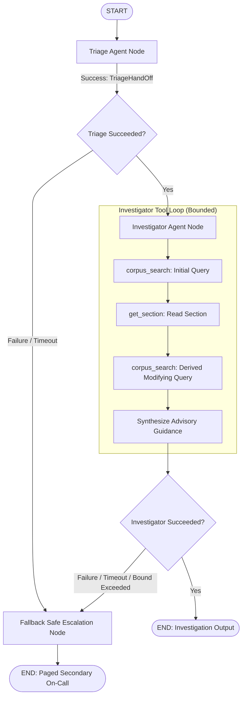

# LangGraph Multi-Agent Topology & Fallback Specification (F3, A1, A2)

## 1. Multi-Agent Reasoning Architecture

The IncidentOps reasoning layer coordinates two specialized, decoupled agents orchestrated as a directed graph in **LangGraph**:

1. **Agent 1: Triage Agent (A1):**
   - Receives the validated `AlertRequest`.
   - Analyzes symptoms and extracts entities (metrics, service names, PostgreSQL dot version, tags).
   - Categorizes the initial hypothesis into strictly one of five cause classes: `saturation`, `contention`, `configuration`, `dependency_failure`, `data_volume`.
   - Produces a strictly typed [`TriageHandOff`](file:///E:/MLSD_MINI/src/agent/state.py) contract containing hypotheses and suggested queries.

2. **Agent 2: Investigator Agent (A2):**
   - Receives the typed `TriageHandOff` within [`AgentState`](file:///E:/MLSD_MINI/src/agent/state.py).
   - Dynamically selects and calls tools:
     - `corpus_search(query, filters)`: Hybrid RRF search across official documentation, runbooks, and policy.
     - `get_section(section_id)`: Deep inspection of specific documentation chapters.
     - `get_alert_field(name)`: Reading specific alert metrics and tags.
   - **Multi-Hop Provision Check:** Reads retrieved sections, checks whether another provision modifies or overrides it (e.g. replication slot retention modifying WAL recycling), and performs a follow-up search using a derived query.
   - Synthesizes root cause class, ordered first-response steps, verified citations (`section_id` + quoted span), severity, and operational routing target.

---

## 2. Graph Topology & State Transitions



---

## 3. Mid-Run Failure Recovery & Fallback Path

### 3.1 Failure Modes Handled
The reasoning layer is designed to gracefully handle partial and total failures during agent execution:
- **LLM Gateway Timeouts / Circuit Breaker Trips:** Cloud provider rate limits, HTTP 500s, or slow responses.
- **Tool Bound Violations:** Exceeding `max_steps` (default: 5), `max_tool_calls` (default: 8), or `wall_clock_timeout_seconds` (default: 30.0s).
- **Tool Execution Errors:** Corrupted corpus sections or malformed parameters.
- **Unparseable LLM Payloads:** Responses failing Pydantic v2 schema validation.

### 3.2 Fallback Invariant
**Invariant:** Under no circumstances does an internal agent exception crash the service or leave an incident unaddressed. If any agent fails mid-run:
1. Graph execution transitions immediately across the conditional error edge to `fallback_node`.
2. The incident is routed to **`page-secondary`** with severity **`SEV2`**.
3. Advisory output clearly states that automated agent analysis aborted mid-run and pages the secondary database engineer for immediate manual triage:
```json
{
  "cause_class": "saturation",
  "first_response_steps": [
    "1. Automated agent reasoning aborted mid-run due to an error/timeout.",
    "2. Secondary database on-call engineer paged immediately for manual diagnostic review.",
    "3. Root cause diagnostic error: Wall-clock timeout exceeded: 30.25s > 30.0s"
  ],
  "citations": [],
  "severity": "SEV2",
  "severity_basis": "Agent execution failure triggers deterministic safe escalation to secondary on-call.",
  "route": "page-secondary"
}
```

---

## 4. Execution Limits & Bounded Reasoning

To prevent unconstrained tool loops or runaway cloud LLM expenditures:

| Bound Guard | Default Limit | Enforcement Mechanism |
|---|:---:|---|
| **Max Reasoning Steps** | `5 steps` | Incremented on each node invocation; checked before tool execution. |
| **Max Tool Calls** | `8 calls` | Guarded in [`AgentToolExecutor.check_bounds()`](file:///E:/MLSD_MINI/src/agent/tools.py). |
| **Wall-Clock Timeout** | `30.0 seconds` | Time elapsed from initial invocation; checked before each tool call. |
| **Response Cache** | Enabled | SHA-256 fingerprint cached in SQLite [`GatewayResponseCache`](file:///E:/MLSD_MINI/src/gateway/client.py). |
| **Prompt Versioning** | Monitored | Every response explicitly stamps `prompt_version` (e.g. `triage-v1.0.0`). |
